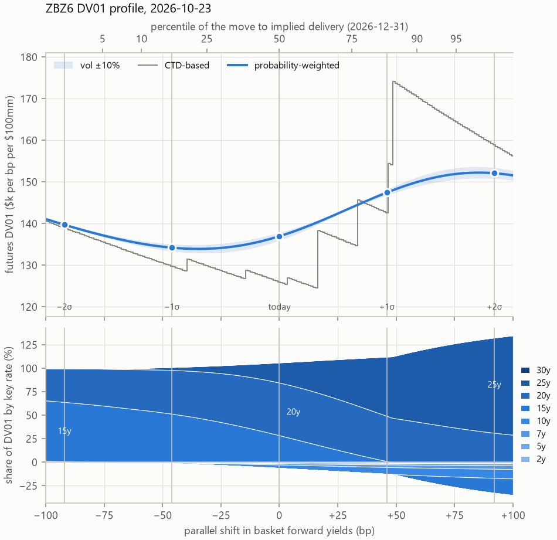
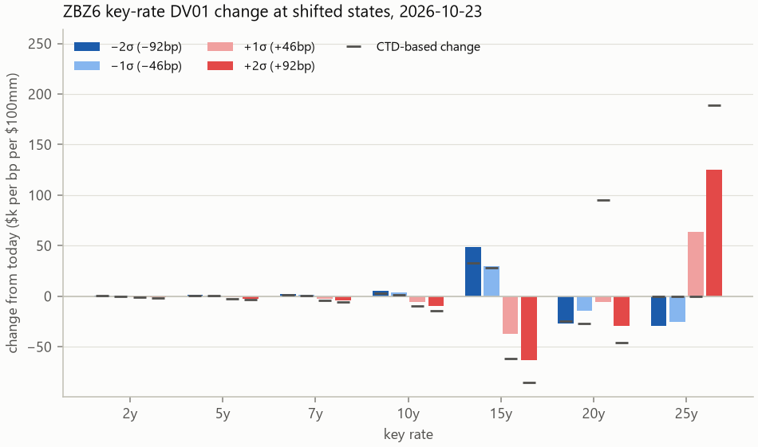
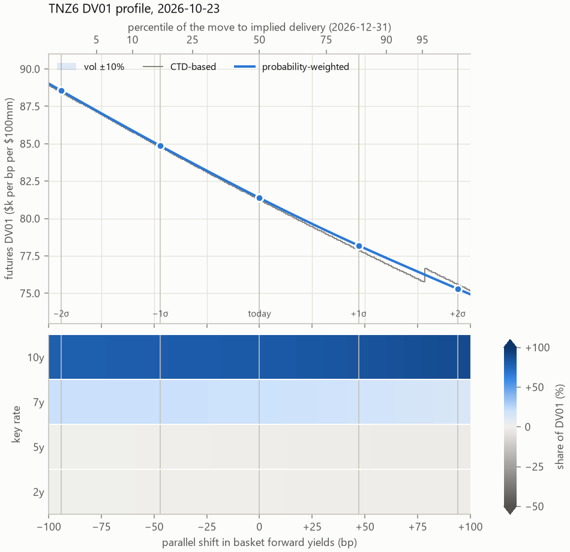
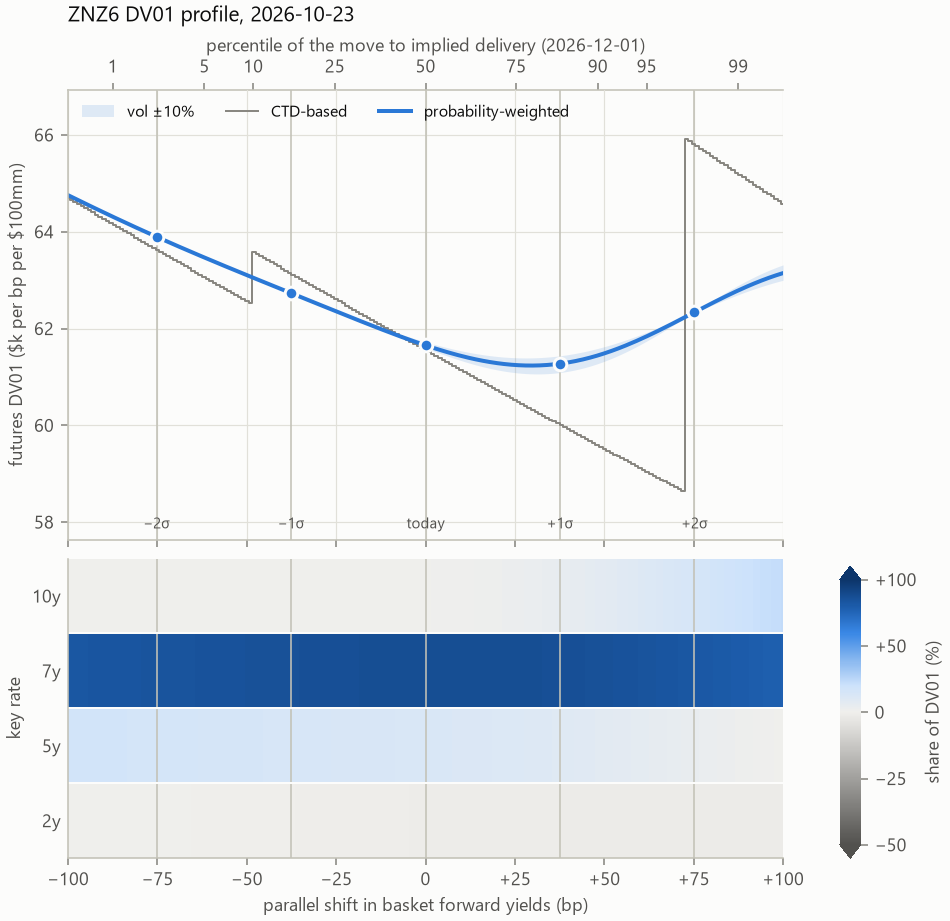

<!--
Figures: python scripts/writeup_figures.py (from data/results/light for 2026-10-23)
Build: pandoc docs/writeup.md -o docs/writeup.pdf --pdf-engine=xelatex --resource-path=docs
Numbers quoted are ZBZ6 on 2026-10-23 (light model) unless stated.
-->

# Summary {-}

Treasury futures risk is usually measured from today's cheapest-to-deliver bond, so the futures DV01 jumps whenever yields move far enough for another bond to become cheapest. The option market already prices the chance of those switches. This write-up weights each deliverable bond by its probability of being cheapest at delivery, which gives a futures DV01 and key rate DV01s that change smoothly as yields move. For the December 2026 bond future (ZBZ6) on 23 October 2026, the probability-weighted DV01 is \$137.0k per bp per \$100mm, against \$126.0k from the CTD alone. After a 49bp sell-off the CTD-based figure jumps to \$174.2k, while the probability-weighted one has risen smoothly to \$148.1k.

# The contract

CBOT Treasury futures (ZN, TN, ZB and UB in this write-up) are agreements to deliver $100,000 face of a Treasury security in the delivery month. The seller (the short) doesn't deliver one specific bond. Any bond in a *basket*, defined by its remaining maturity on the first day of the delivery month, can be delivered:

| Contract | Deliverable remaining maturity | Basket span |
|---|---|---|
| ZN (10-year) | 6.5 to 8 years (notes of original term up to 10 years) | about 1.5 years |
| TN (Ultra 10-year) | 9 years 5 months to 10 years | about 0.6 years |
| ZB (T-bond) | 15 to under 25 years | about 10 years |
| UB (Ultra bond) | 25 years and over | about 5 years |

The bonds in a basket have different coupons and maturities, so they are worth very different amounts. To make them comparable, each bond has a **conversion factor** (CF): its price per $1 face at a 6% yield. A short who delivers bond $i$ receives the invoice price

$$\text{invoice}_i = F \cdot \text{CF}_i + \text{accrued}_i,$$

where $F$ is the futures price. The short buys the bond at its forward price $P_i$ and receives $F \cdot \text{CF}_i$, so it delivers the bond with the lowest **converted price** $P_i / \text{CF}_i$: the **cheapest to deliver** (CTD). At delivery, the futures price converges to that minimum, and before delivery it trades close to it:

$$F \approx \min_i \frac{P_i}{\text{CF}_i}.$$

The future therefore behaves like the CTD scaled by its conversion factor, and so does its interest rate risk: the futures DV01 is approximately the CTD's forward DV01 divided by its CF. That holds only while the CTD stays the same bond.

# The quality option

Conversion factors price every bond at a 6% yield. If every bond in the basket yielded exactly 6%, every converted price would be 100 and no bond would be cheapest. Away from 6%, the factors stop equalising the bonds:

- **Yields above 6%**: high-duration bonds (long maturity, low coupon) lose the most value, and become cheapest to deliver.
- **Yields below 6%**: low-duration bonds become cheapest.

Coupons and the shape of the curve shift these boundaries, but the rule of thumb holds. So which bond is cheapest depends on the level of yields, and the short's right to choose is an option: the **quality option**. Each bond's converted forward price falls as yields rise, at a rate set by its duration, so the bonds' price lines cross. The futures price follows the lowest of them (the envelope), and each place where the lowest line changes is a **switch point**. Figure 1 shows this for ZBZ6. In the top panel the envelope bends at each switch point, getting steeper in a sell-off as longer bonds take over, but the converted prices are so close that the switches are hard to see. The bottom panel measures each bond's converted price above the cheapest one instead: the envelope becomes the zero line, and a switch point is where another bond's line comes down to meet it.

{width=90%}

The quality option matters most when:

- **The basket is wide.** ZB's basket spans 15 to 25 years of maturity, so its bonds' durations differ widely and a switch changes the futures DV01 a lot. TN's basket is under a year wide, and UB's switches are between 30-year bonds of similar duration, so both stay stable. ZN sits in between; its basket narrowed from 6.5–10 years to 6.5–8 years from the September 2023 contract.
- **Yields are near 6%.** Converted prices bunch together, so small moves reorder them and switch points sit close to the current yield level.

ZB at the end of October 2026 shows both effects. Its December contract (ZBZ6) has 59 deliverable bonds maturing between 2042 and 2051. With forward yields around 5.4%, the CTD is a mid-basket bond, the 4.625% of November 2044. Table 1 lists the switch points, the bond that becomes cheapest beyond each one, and the option market's probability of reaching it (the two estimates are described in Section 4). The next switch, to a longer bond, is only 4bp of sell-off away. Five switches lie within 50bp on the sell-off side, each to a longer, lower-coupon bond, and two lie within 40bp on the rally side. The expected move in yields to delivery is about 46bp (one standard deviation, implied by options). The option market puts the chance of crossing the next switch alone at about 45%, and gives today's CTD only a 25% chance of still being cheapest when the options expire in late November (about 15% by delivery at the end of December).

| Switch (bp) | Futures price $K_k$ | CTD beyond the switch | Digital | Normal | Gap |
|-------:|----------:|------------------:|------:|------:|-----:|
| $-39.6$ | 112.34 | 4.75% Nov 2043 | 7.3% | 8.9% | $-1.6$ |
| $-14.2$ | 109.06 | 4.625% May 2044 | 29.2% | 31.4% | $-2.2$ |
| $+3.8$ | 106.78 | 4.875% Aug 2045 | 45.8% | 44.9% | $+0.9$ |
| $+16.8$ | 105.14 | 2.875% Aug 2045 | 27.4% | 28.4% | $-1.0$ |
| $+34.0$ | 102.80 | 2.25% Aug 2046 | 10.8% | 12.3% | $-1.5$ |
| $+46.6$ | 100.98 | 2.25% Aug 2049 | 4.7% | 5.6% | $-0.9$ |
| $+48.3$ | 100.71 | 1.375% Aug 2050 | 4.7% | 5.0% | $-0.3$ |
| $+126.1$ | 88.21 | 1.25% May 2050 | 1.6% | 0.0% | $+1.6$ |

: ZBZ6 switch points on 2026-10-23: probability of the futures price passing each switch point by option expiry (20 November), from put and call spreads (digital) and from the normal model at the at-the-money vol; the gap is in percentage points. The futures settlement was 107.25.

Each switch changes the bond that the future tracks, and with it the futures DV01 and its spread across maturities. A risk number based on today's CTD alone jumps at each switch point.

# How futures risk is usually reported

The standard approach treats the future as its CTD. The futures DV01 is the CTD's forward DV01 divided by its conversion factor, and the futures key rate DV01s are the CTD's key rate DV01s divided by the same factor. Many vendor risk systems and dealer risk runs report futures risk this way by default.

It is simple and transparent, and it is right while the CTD is stable: for TN, usually for UB, and for ZB when yields are far from 6%. It fails when a switch is near:

- **The DV01 jumps.** For ZBZ6 on 23 October 2026, the CTD-based DV01 is \$126.0k per bp per \$100mm. A 47bp sell-off moves the CTD to a longer bond and the figure to \$154.4k; two basis points further, it is \$174.2k.
- **The key rate exposure jumps between maturities.** At each switch, risk moves from one key rate to another, for ZB from 15 years to 20 and 25 years. A curve hedge built on today's CTD is wrong on both sides of a switch.
- **It ignores what the market prices.** Options on the futures put a 75% chance on today's ZBZ6 CTD being replaced by option expiry, and more by delivery. A CTD-based number assigns that a weight of zero until the switch happens.

<!-- TODO: option-adjusted vendor measures: mention only with a citation. -->

This write-up replaces "the CTD" with every deliverable bond, each weighted by its probability of being cheapest at delivery.

# Approach

The model runs at the end of each day from public data: Treasury prices, CME futures and option settlements, conversion factors, SOFR futures and the Treasury par curve. It has four steps.

**Forward prices.** Each deliverable bond is priced forward to delivery at term repo, built from the SOFR futures strip, and divided by its conversion factor. Delivery is assumed on the last day of the month when carry is positive (as for ZBZ6, on 31 December 2026), and on the first day when it is negative.[^carry]

[^carry]: The sign is that of the basket's probability-weighted carry, $\sum_i p_i\,(C_{i,\text{first}} - C_{i,\text{last}})$: each bond's converted forward price on the first delivery day less on the last, weighted by its option-implied probability $p_i$ of being CTD. Following today's CTD alone would make the date flip each time two bonds of opposite carry trade places, as ZN's did 13 times between September and October 2026.

**Switch points.** Every bond's forward yield is shifted in parallel by $z$ basis points, and each bond is repriced. The envelope $E(z) = \min_i P_i(z)/\text{CF}_i$ is the model's futures price at delivery, and the shifts $z_k$ where its minimum changes bond are the switch points, found exactly by root-finding. Each switch point is also expressed as a futures price, recentred on the market settlement:

$$K_k = F_\text{market} + E(z_k) - E(0).$$

**Switch probabilities.** The probability of reaching each switch point is estimated in two ways, both from CME's option settlements.

- *Digitals from option settlements.* The slope of put prices across strikes is the probability that the futures price finishes below the strike. Taking the listed strikes either side of $K_k$,
  $$P(F < K_k) \approx \frac{\text{Put}(K_\text{hi}) - \text{Put}(K_\text{lo})}{K_\text{hi} - K_\text{lo}} \cdot \frac{1}{\text{DF}},$$
  with $\text{DF}$ the discount factor to expiry, and calls on the rally side. It needs no option pricing model of its own and keeps the skew in the settlements. It is noisy, though: premiums settle in 64ths, so a single put spread is uncertain by up to about 3 percentage points. It also measures the probability at option expiry (20 November for ZBZ6), not at delivery. Differences of successive digitals give each bond's probability of being CTD.
- *Normal model.* The at-the-money price vol of the same options is converted to a yield vol with the CTD's DV01: $\sigma_y = \sigma_\text{price} / (\text{DV01}_\text{CTD}/\text{CF}_\text{CTD})$. Scaled to delivery, it gives the width of the yield distribution, $S = \sigma_y\sqrt{T}$ (46bp for ZBZ6), and the probability of passing switch point $k$ is
  $$Q_k = \Phi\!\left(-\frac{|z_k|}{S}\right).$$
  This ignores skew, but it is smooth and gives a full distribution of yields at delivery, which the risk calculation needs.

Where the two agree, skew matters little; the gap between them measures how much the option smile adds.

Option probabilities and the ATM vol come from CME settlement prices, which CME sets from its implied-vol skew whether or not a strike traded; they are option-implied, not traded prices. The report shows which strikes behind each one traded that day. For ZB and ZN nearly all did; for UB and TN most did not, so their probabilities, and often their at-the-money vol, rest on CME's skew rather than that day's trades.

**Risk.** Yields at delivery are taken as normal around today's forwards, $z \sim N(0, S^2)$. At each $z$, the futures DV01 is the DV01 of the bond that is cheapest there, divided by its conversion factor and evaluated at those shifted yields. The model's futures DV01 is its average over the distribution:

$$\text{DV01}_F = \mathbb{E}\left[\frac{\text{DV01}_{\text{CTD}(z)}(z)}{\text{CF}_{\text{CTD}(z)}}\right].$$

Each bond therefore counts in proportion to its probability of being CTD, at the yields where it would be. This equals the sensitivity of the expected futures price at delivery to a parallel shift in yields. Key rate DV01s are averaged the same way, from tent-shaped bumps to the Treasury par curve at 2, 5, 7, 10, 15, 20, 25 and 30 years. For the duration profile, the centre of the distribution is moved from $-100$ to $+100$bp and everything is recomputed, including the switch probabilities, with $\pm1\sigma$ and $\pm2\sigma$ marked.

What the model leaves out is deliberate. It has no futures fair value and no implied repo, and it doesn't value the end-of-month or wildcard delivery options. Every bond is funded at general collateral repo.

# Results: ZB, December 2026

Figure 2 is the main output: the futures DV01 across parallel shifts in yields, from the model (blue) and from the CTD alone (grey).

- **Today** the model's DV01 is \$137.0k per bp per \$100mm, against \$126.0k CTD-based. The model is higher because the next switch, to a longer bond, is only 4bp of sell-off away and carries a 45% probability. The model already counts the duration the future would gain there.
- **Within $\pm1\sigma$** (46bp), the model's DV01 moves smoothly between \$134.2k and \$147.5k. The CTD-based figure steps through six bonds over the same range, and within 3bp past $+1\sigma$ it jumps from \$142.6k to \$174.2k.
- **At $\pm2\sigma$**, the gap narrows. At $-2\sigma$ almost all the probability is on one bond, and the two agree (\$139.7k against \$139.0k). At $+2\sigma$ the CTD-based figure is now the higher one (\$158.9k against \$152.1k), because the model still gives weight to the shorter bonds a rally back would restore.

The model's DV01 is lowest about 35bp below today's yields. In a rally, each bond's own DV01 rises, but the CTD also moves to shorter bonds; near today's level the second effect wins.

{width=90%}

{width=90%}

The key rate split matters as much as the total (Figure 2, bottom, and Figure 3). Today the CTD, the 4.625% of November 2044, has no 25-year exposure at all: \$53.3k at 15 years and \$75.7k at 20 years. The model puts \$29.4k at 25 years, because the bonds a sell-off would make cheapest mature in 2045 to 2050. After a $+1\sigma$ sell-off, the CTD-based split puts \$171.1k at 20 years and still nothing at 25 years; the model has \$93.1k at 25 years and \$70.9k at 20 years. A curve hedge sized on the CTD alone would miss the long end in a sell-off, and then overcorrect when the CTD finally switches.

Table 2, a copy of Table 1, compares the two probability estimates at each switch point. For a like-for-like comparison, the normal model here uses the width to option expiry (29bp), not to delivery.

| Switch (bp) | Futures price $K_k$ | CTD beyond the switch | Digital | Normal | Gap |
|-------:|----------:|------------------:|------:|------:|-----:|
| $-39.6$ | 112.34 | 4.75% Nov 2043 | 7.3% | 8.9% | $-1.6$ |
| $-14.2$ | 109.06 | 4.625% May 2044 | 29.2% | 31.4% | $-2.2$ |
| $+3.8$ | 106.78 | 4.875% Aug 2045 | 45.8% | 44.9% | $+0.9$ |
| $+16.8$ | 105.14 | 2.875% Aug 2045 | 27.4% | 28.4% | $-1.0$ |
| $+34.0$ | 102.80 | 2.25% Aug 2046 | 10.8% | 12.3% | $-1.5$ |
| $+46.6$ | 100.98 | 2.25% Aug 2049 | 4.7% | 5.6% | $-0.9$ |
| $+48.3$ | 100.71 | 1.375% Aug 2050 | 4.7% | 5.0% | $-0.3$ |
| $+126.1$ | 88.21 | 1.25% May 2050 | 1.6% | 0.0% | $+1.6$ |

: ZBZ6 switch points on 2026-10-23: probability of the futures price passing each switch point by option expiry (20 November), from put and call spreads (digital) and from the normal model at the at-the-money vol; the gap is in percentage points. The futures settlement was 107.25.

Within $\pm1.5\sigma$, the two agree to about 2 percentage points, inside the noise of a single put spread. The only real gap is in the far wing: the switch at $+126$bp is more than $4\sigma$ away at the width to option expiry, where the normal model gives nothing and the option settlements still price 1.6%. That is skew, though at that distance it rests on how CME extrapolates its settlement curve, so it is only indicative.

## Comparison with TN and ZN

TN is the contract least prone to switching. Its December basket has only two notes, three months apart in maturity: the 4.375% of May 2036 (the CTD) and the 4.625% of August 2036. The one switch point is 78bp of sell-off away ($1.7\sigma$), and the two notes' durations barely differ, so the probability-weighted and CTD-based DV01s lie almost on top of each other (Figure 4). The DV01 falls steadily, from \$88.5k at $-2\sigma$ to \$75.3k at $+2\sigma$, through the notes' own convexity alone. For TN, the CTD-based figure is the right answer.

{width=75%}

ZN sits in between, and shows the shape the quality option gives a duration profile. Its December basket has 10 notes maturing between June 2033 and November 2034. With forward yields near 4.9%, well below 6%, the CTD is one of the shortest notes, the 3.875% of August 2033. It is nearly tied with the 4.5% of August 2033, which matures two weeks later and takes over after only 4.5bp of rally, so the options give the CTD only about a 55% chance of remaining CTD. That switch hardly matters for risk, since the two notes have almost the same duration. The one that matters is 72bp of sell-off away ($1.4\sigma$), to the 3.875% of August 2034, a year longer. Two effects pull against each other in a sell-off: the notes' convexity lowers the DV01, and the growing chance of a switch to the longer note raises it. The probability-weighted DV01 is therefore U-shaped (Figure 5). It is lowest, at \$61.1k, about 15bp above today's yields, and rises on both sides: to \$64.0k at $-2\sigma$ and \$62.5k at $+2\sigma$. The CTD-based figure instead keeps falling, to about \$58.1k, then jumps by about \$7k (13%) at the switch.

{width=75%}

# Validation

- **Bond math.** All prices, yields, accrued interest and DV01s come from one hand-written street-convention pricing function. Price and yield round trips agree to $10^{-10}$, and prices match QuantLib, used only as an independent test.
- **Conversion factors and baskets.** Conversion factors from CME's formula match every row of CME's published tables collected so far. Baskets are rebuilt from the eligibility rules and checked against the same tables, including bonds crossing the ZN grade change in 2023 and the 25-year boundary between ZB and UB.
- **The model's mechanics.** Switch points are tested on a two-bond basket with a known answer. On a flat 6% curve every converted price is close to 100. The probability-weighted DV01 matches the slope of the expected envelope computed by finite differences.
- **Probabilities.** The two independent estimates agree to within the noise of the option settlements (Table 2). Where the same day's options are available from two sources, CME's daily bulletin and a commercial data history, they give the same vol and DV01; only far-wing probabilities differ, by up to a percentage point.

**Not yet done: a historical backtest.** The real test of the probabilities is whether bonds given a 30% chance of being CTD turn out to be CTD about 30% of the time. The plan is to run the model over past delivery cycles with large moves, such as the 2022–23 sell-off. Its probabilities would then be scored against the bond actually cheapest at delivery, with a Brier score and a reliability plot, contract by contract.

# Potential future work

**Betas.** The model shifts every forward yield by the same amount. In practice yields across a 10-year basket don't move one-for-one: the curve tends to steepen or flatten as its level changes. One option is to regress yield changes at each published tenor on one reference yield per contract (the 20-year for ZB). Each bond then moves by its own beta, interpolated at its maturity. Betas would be re-estimated daily, so the DV01 series doesn't jump when they are refitted; shrunk slightly towards 1; and also estimated on sell-off days alone, in case those differ. Switch points depend on differences in beta between bonds. For ZB, a beta error of 0.03 moves a switch 30bp away by about 1bp. The leftover curve noise the betas don't explain also widens the probabilities around switch points that are close together.

**The option smile.** The normal model uses one at-the-money vol and ignores skew. A replacement would fit a normal SABR smile to each option expiry and take the probabilities from the fitted curve's slope across strikes. This gives one consistent distribution for every switch point, with skew, and tail probabilities that can't be negative. Unlike today's digitals, it also gives a density, so the DV01 profile and key rate DV01s would reflect the skew too. The distribution would be extended from option expiry to delivery by adding normally distributed yield moves over the remaining time. The raw put-spread digitals then become the check on the fit. Far wings need care: when far out-of-the-money options are priced rich or at their minimum tick, the fitted tails come out too fat.

**An interest rate model.** One factor can't represent slope moves independent of the level. Yet for a basket that spans 15 to 25 years, slope moves alone can cause a switch. A two-factor model of the curve (or a full term structure model), calibrated to the options, would price those switches directly. It would give probabilities at delivery rather than at option expiry, and is the route to valuing the end-of-month and wildcard options and a futures fair value, all of which are out of scope today.

The futures themselves could help calibrate such a model. A futures price sits below the cheapest converted forward price by the value of the short's delivery options. The quality option's share of that value depends on how likely the curve is to steepen or flatten enough to cause a switch. Across contracts and over time, futures prices therefore carry information about slope volatility, and about how slope moves with the level of yields, that options on the level alone don't reveal. The obstacle is repo. A futures price also depends on the repo rate of the likely CTD: when that bond is special, its carry is higher and its forward price lower, which pushes the futures price down in the same direction as the delivery options. The model funds every bond at general collateral, because the special repo rates the market expects for the CTD are hard to get. Public repo benchmarks, such as SOFR and the New York Fed's other reference rates, are general collateral rates that say nothing about any one bond. Repo on a specific bond trades bilaterally between dealers, so its rates are seen on dealer and interdealer platforms and sold commercially; there is no free daily history by bond. What matters for the futures price is also a term rate, the special rate expected through delivery, which is harder still to observe than overnight. So the gap between the futures settlement and the model's envelope (1.3/32nds for ZBZ6 on 23 October) mixes the two, and a slope signal can't be separated from it cleanly without a view on the CTD's repo.

**Bond-specific spreads.** Individual bonds trade rich or cheap to the curve, and a bond in demand can be special in repo, with financing well below general collateral. The model prices each bond from its own price and funds all of them at general collateral repo. A few basis points of richness, or special repo on one bond, can move a switch point. Modelling spreads as mean-reverting, and adding bond-specific repo where a data source exists, would address this.

# Limitations

Beyond what the potential future work above addresses:

- **The probabilities are risk-neutral.** They come from option prices, which include a risk premium, so they are the market's pricing of a switch, not a forecast of one.
- **Free prices are imperfect.** Treasury's published end-of-day prices are rounded and aren't struck at the same moment as the futures settlement. A few ticks of noise can move a switch point by a basis point or two.
- **Thin options for UB and TN.** Few of their option strikes trade on a given day, so their probabilities, and often their at-the-money vol, rest on CME's settlement curve rather than that day's trades.