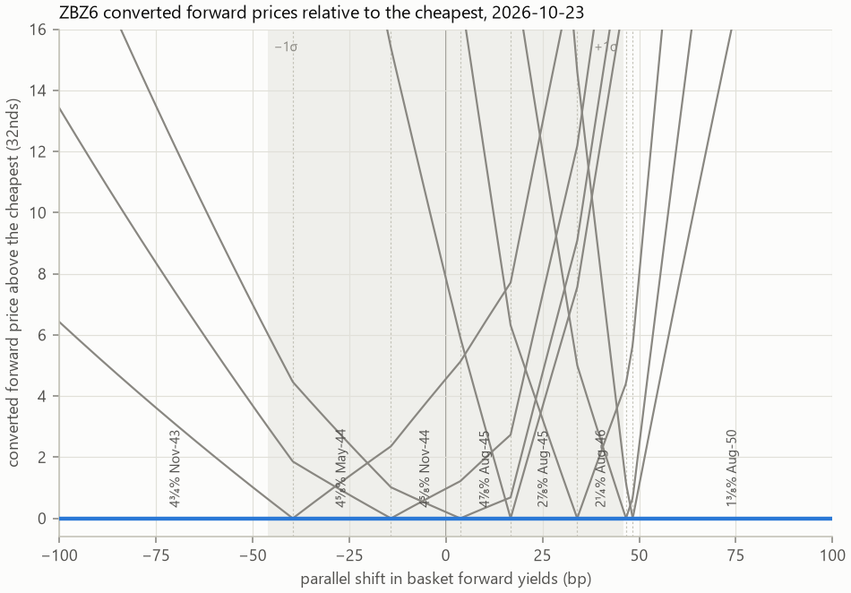
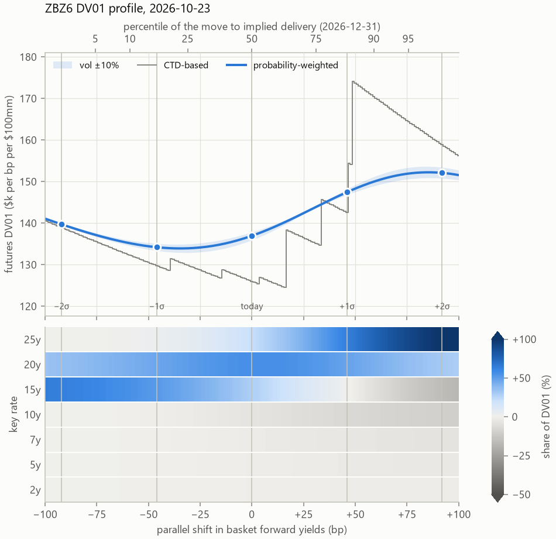

<!--
Build: pandoc docs/writeup.md -o docs/writeup.pdf --pdf-engine=xelatex --resource-path=docs
Numbers quoted are ZBZ6 on 2026-10-23 (light model) unless stated.
-->

# Summary {-}

Treasury futures risk is usually measured from today's cheapest-to-deliver bond, so the futures DV01 jumps whenever yields move far enough for another bond to become cheapest. The option market already prices the chance of those switches. This write-up weights each deliverable bond by its probability of being cheapest at delivery, which gives a futures DV01 and key rate DV01s that change smoothly as yields move. For the December 2026 bond future (ZBZ6) on 23 October 2026, the probability-weighted DV01 is \$137.0k per bp per \$100mm, against \$126.0k from the CTD alone. After a 49bp sell-off the CTD-based figure jumps to \$174.2k, while the probability-weighted one has risen smoothly to \$148.1k.

# The contract

CBOT Treasury futures (ZN, TN, ZB and UB in this write-up) are agreements to deliver $100,000 face of a Treasury security in the delivery month. The seller (the short) doesn't deliver one specific bond. Any bond in a *basket*, defined by its remaining maturity on the first day of the delivery month, can be delivered:

| Contract | Deliverable remaining maturity | Basket span |
|---|---|---|
| ZN (10-year) | 6.5 to 8 years (notes of original term up to 10 years) | about 1.5 years |
| TN (Ultra 10-year) | 9 years 5 months to 10 years | about 0.6 years |
| ZB (T-bond) | 15 to under 25 years | about 10 years |
| UB (Ultra bond) | 25 years and over | about 5 years |

The bonds in a basket have different coupons and maturities, so they are worth very different amounts. To make them comparable, each bond has a **conversion factor** (CF): its price per $1 face at a 6% yield. A short who delivers bond $i$ receives the invoice price

$$\text{invoice}_i = F \cdot \text{CF}_i + \text{accrued}_i,$$

where $F$ is the futures price. The short buys the bond at its forward price $P_i$ and receives $F \cdot \text{CF}_i$, so it delivers the bond with the lowest **converted price** $P_i / \text{CF}_i$: the **cheapest to deliver** (CTD). At delivery, the futures price converges to that minimum, and before delivery it trades close to it:

$$F \approx \min_i \frac{P_i}{\text{CF}_i}.$$

The future therefore behaves like the CTD scaled by its conversion factor, and so does its interest rate risk: the futures DV01 is approximately the CTD's forward DV01 divided by its CF. That holds only while the CTD stays the same bond.

# The quality option

Conversion factors price every bond at a 6% yield. If every bond in the basket yielded exactly 6%, every converted price would be 100 and no bond would be cheapest. Away from 6%, the factors stop equalising the bonds:

- **Yields above 6%**: high-duration bonds (long maturity, low coupon) lose the most value, and become cheapest to deliver.
- **Yields below 6%**: low-duration bonds become cheapest.

Coupons and the shape of the curve shift these boundaries, but the rule of thumb holds. So which bond is cheapest depends on the level of yields, and the short's right to choose is an option: the **quality option**. Figure 1 shows how it works. Each bond's converted forward price falls as yields rise, at a rate set by its duration. The futures price follows the lowest of them (the envelope), and each kink in the envelope is a **switch point** where the CTD changes.

<!-- TODO: Figure 1. Converted forward price against parallel yield shift for
3-4 ZBZ6 bonds, envelope highlighted, switch points marked.
 -->

The quality option matters most when:

- **The basket is wide.** ZB's basket spans 15 to 25 years of maturity, so its bonds' durations differ widely and a switch changes the futures DV01 a lot. TN's basket is under a year wide, and UB's switches are between 30-year bonds of similar duration, so both stay stable. ZN sits in between; its basket narrowed from 6.5–10 years to 6.5–8 years from the September 2023 contract.
- **Yields are near 6%.** Converted prices bunch together, so small moves reorder them and switch points sit close to the current yield level.

ZB at the end of October 2026 shows both effects. Its December contract (ZBZ6) has 59 deliverable bonds maturing between 2042 and 2051. With forward yields around 5.4%, the CTD is a mid-basket bond, the 4.625% of November 2044. The next switch, to a longer bond, is only 4bp of sell-off away. Five switches lie within 50bp on the sell-off side, each to a longer, lower-coupon bond, and two lie within 40bp on the rally side. The expected move in yields to delivery is about 46bp (one standard deviation, implied by options). The option market puts the chance of crossing the next switch alone at about 45%, and gives today's CTD only a 25% chance of still being cheapest when the options expire in late November (about 15% by delivery at the end of December).

Each switch changes the bond that the future tracks, and with it the futures DV01 and its spread across maturities. A risk number based on today's CTD alone jumps at each switch point.

# How futures risk is usually reported

The standard approach treats the future as its CTD. The futures DV01 is the CTD's forward DV01 divided by its conversion factor, and the futures key rate DV01s are the CTD's key rate DV01s divided by the same factor. Many vendor risk systems and dealer risk runs report futures risk this way by default.

It is simple and transparent, and it is right while the CTD is stable: for TN, usually for UB, and for ZB when yields are far from 6%. It fails when a switch is near:

- **The DV01 jumps.** For ZBZ6 on 23 October 2026, the CTD-based DV01 is \$126.0k per bp per \$100mm. A 47bp sell-off moves the CTD to a longer bond and the figure to \$154.4k; two basis points further, it is \$174.2k.
- **The key rate exposure jumps between maturities.** At each switch, risk moves from one key rate to another, for ZB from 15 years to 20 and 25 years. A curve hedge built on today's CTD is wrong on both sides of a switch.
- **It ignores what the market prices.** Options on the futures put a 75% chance on today's ZBZ6 CTD being replaced by option expiry, and more by delivery. A CTD-based number assigns that a weight of zero until the switch happens.

<!-- TODO: option-adjusted vendor measures: mention only with a citation. -->

This write-up replaces "the CTD" with every deliverable bond, each weighted by its probability of being cheapest at delivery.

# Approach

The model runs at the end of each day from public data: Treasury prices, CME futures and option settlements, conversion factors, SOFR futures and the Treasury par curve. It has four steps.

**Forward prices.** Each deliverable bond is priced forward to delivery at term repo, built from the SOFR futures strip, and divided by its conversion factor. Delivery is assumed on the last day of the month when carry is positive (as for ZBZ6, on 31 December 2026), and on the first day when it is negative.

**Switch points.** Every bond's forward yield is shifted in parallel by $z$ basis points, and each bond is repriced. The envelope $E(z) = \min_i P_i(z)/\text{CF}_i$ is the model's futures price at delivery, and the shifts $z_k$ where its minimum changes bond are the switch points, found exactly by root-finding. Each switch point is also expressed as a futures price, recentred on the market settlement:

$$K_k = F_\text{market} + E(z_k) - E(0).$$

**Switch probabilities.** The probability of reaching each switch point is estimated in two ways, both from CME's option settlements.

- *Digitals from option settlements.* The slope of put prices across strikes is the probability that the futures price finishes below the strike. Taking the listed strikes either side of $K_k$,
  $$P(F < K_k) \approx \frac{\text{Put}(K_\text{hi}) - \text{Put}(K_\text{lo})}{K_\text{hi} - K_\text{lo}} \cdot \frac{1}{\text{DF}},$$
  with $\text{DF}$ the discount factor to expiry, and calls on the rally side. It needs no option pricing model of its own and keeps the skew in the settlements. It is noisy, though: premiums settle in 64ths, so a single put spread is uncertain by up to about 3 percentage points. It also measures the probability at option expiry (20 November for ZBZ6), not at delivery. Differences of successive digitals give each bond's probability of being CTD.
- *Normal model.* The at-the-money price vol of the same options is converted to a yield vol with the CTD's DV01: $\sigma_y = \sigma_\text{price} / (\text{DV01}_\text{CTD}/\text{CF}_\text{CTD})$. Scaled to delivery, it gives the width of the yield distribution, $S = \sigma_y\sqrt{T}$ (46bp for ZBZ6), and the probability of passing switch point $k$ is
  $$Q_k = \Phi\!\left(-\frac{|z_k|}{S}\right).$$
  This ignores skew, but it is smooth and gives a full distribution of yields at delivery, which the risk calculation needs.

Where the two agree, skew matters little; the gap between them measures how much the option smile adds.

Option probabilities and the ATM vol come from CME settlement prices, which CME sets from its implied-vol skew whether or not a strike traded; they are option-implied, not traded prices. The report shows which strikes behind each one traded that day. For ZB and ZN nearly all did; for UB and TN most did not, so their probabilities, and often their at-the-money vol, rest on CME's skew rather than that day's trades.

**Risk.** Yields at delivery are taken as normal around today's forwards, $z \sim N(0, S^2)$. At each $z$, the futures DV01 is the DV01 of the bond that is cheapest there, divided by its conversion factor and evaluated at those shifted yields. The model's futures DV01 is its average over the distribution:

$$\text{DV01}_F = \mathbb{E}\left[\frac{\text{DV01}_{\text{CTD}(z)}(z)}{\text{CF}_{\text{CTD}(z)}}\right].$$

Each bond therefore counts in proportion to its probability of being CTD, at the yields where it would be. This equals the sensitivity of the expected futures price at delivery to a parallel shift in yields. Key rate DV01s are averaged the same way, from tent-shaped bumps to the Treasury par curve at 2, 5, 7, 10, 15, 20, 25 and 30 years. For the duration profile, the centre of the distribution is moved from $-100$ to $+100$bp and everything is recomputed, including the switch probabilities, with $\pm1\sigma$ and $\pm2\sigma$ marked.

What the model leaves out is deliberate. It has no futures fair value and no implied repo, and it doesn't value the end-of-month or wildcard delivery options. Every bond is funded at general collateral repo.

# Results: ZB, December 2026

{width=90%}

{width=90%}

<!-- TODO:
- Walk through the two figures. Numbers ($k per bp per $100mm, prob-weighted /
  CTD-based): -2sigma (-92bp) 139.7 / 139.0; -1sigma (-46bp) 134.2 / 129.8;
  today 137.0 / 126.0; +1sigma (+46bp) 147.5 / 142.6; +2sigma (+92bp) 152.1 / 158.9.
  CTD-based jumps 142.6 -> 154.4 at +47bp and -> 174.2 at +49bp.
- Key rates: weight moves from 15y to 20-25y in a sell-off; CTD-based moves in jumps.
- Distance to next switch: +3.8bp (0.08 sigma) sell-off, -14.2bp rally; width 46bp.
- Table per switch point: K_k, digital, normal, gap.
- Optional: ZN or UB contrast. -->

# Validation

<!-- TODO: bond math vs QuantLib; CFs vs CME tables; the two probability
estimates agree; historical backtest not yet done. -->

# Further work

<!-- TODO, one short paragraph each:
- Betas: non-parallel moves; sell-off betas; shrinkage; daily re-estimation;
  20y sector reference; residual slope variance widens probabilities.
- SABR smile: normal SABR per expiry; digitals from the fitted put curve;
  monotone tails; convolution from expiry to delivery; wing caveat.
- Interest rate model: two-factor or term-structure model for slope risk;
  horizon at delivery; timing options and fair value.
- Bond-specific spreads (brief): rich/cheap issues and special repo move
  switch points; mean-reverting spreads, bond-level betas, CTD repo. -->

# Limitations

<!-- TODO: risk-neutral probabilities; lagged, rounded free prices; thin UB options. -->
